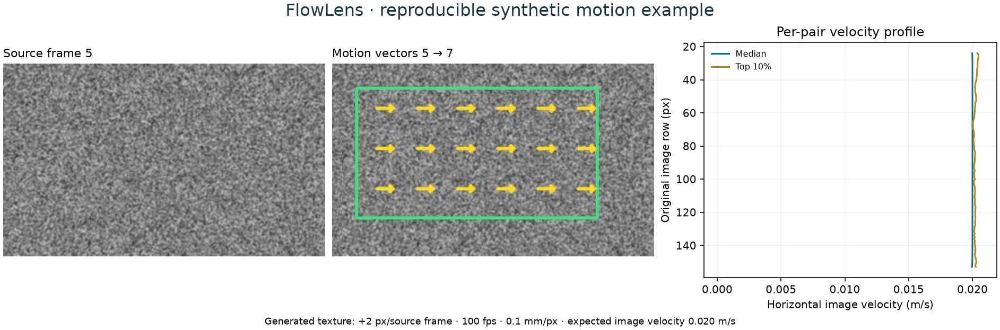

# FlowLens

**Scientific video analysis with Python, a C# Windows desktop, and a JavaScript results viewer.**

Created by **Chuang Xiao**. This source portfolio turns an experimental oil–water video workflow into a researcher-facing application: choose a recording and frame range, review flow-pattern/interface predictions when local models are available, measure image motion, and export results with settings and provenance.

The repository includes a runnable **synthetic motion validation** and small browser-ready results. Research recordings, manually annotated crops, trained research models, installed runtimes and executables are separate local assets.



*Python-generated analysis output. The browser viewer reviews the same numerical exports interactively.*

## Try the browser demo in one minute

From the repository root, using Python 3:

```sh
python -m http.server 8000 --bind 127.0.0.1 --directory web
```

Open **http://127.0.0.1:8000**. No npm installation, model or GPU is needed. The committed example uses the actual Python engine's exported JSON and previews.

Use the pair slider, switch between frames A/B, and inspect synchronized source images, motion vectors and velocity profiles. To inspect your own exports, select `timeline.json`, optional `interface.json`, and the JPEG/PNG previews together. Files are read locally in the browser. See [the export contract](docs/export-contract.md).

## What this code demonstrates

| Component | Representative code | Engineering focus |
|---|---|---|
| Python / OpenCV | [demo runner](scripts/demo.py), [motion worker](engine/worker.py), [profiles](engine/timeline.py) | Frame selection, gap normalization, scientific units, missing data and reproducible exports |
| Python / PyTorch | [boundary model and device fallback](engine/torch_interface.py), [offline trainer](engine/train_torch_interface.py) | Image-based inference, safe checkpoint loading, CUDA detection, same-model CPU fallback and video-level holdout |
| C# / .NET / WPF | [worker client](desktop/WorkerClient.cs), [workflow controller](desktop/WorkflowNavigator.cs), [session state](desktop/AnalysisSessionState.cs) | Responsive UI, JSON process communication, staged workflows, caching, cancellation and result lifetime |
| JavaScript / HTML / CSS | [viewer](web/app.js), [data validation](web/model.js), [tests](web/tests/model.test.mjs) | Local file handling, interactive SVG charts, synchronized navigation, unit checks and null-preserving plots |

Read [the architecture](docs/architecture.md), [code walkthrough](docs/code-walkthrough.md), and [development notes](docs/development-notes.md) for design decisions and tradeoffs.

## Reproduce the Python example

Python **3.12** is the tested development version.

```sh
python -m venv .venv
# Windows: .venv\Scripts\activate
# macOS/Linux: source .venv/bin/activate
python -m pip install -r requirements.txt
python scripts/demo.py
python -m unittest discover -s tests -v
```

The generated texture moves **+2 px per source frame**. With 100 fps and an illustrative scale of 0.1 mm/px, expected image velocity is **0.020 m/s**. The analysis uses a two-frame gap and three-frame spacing to exercise indexing and normalization. The runner checks the measured displacement before copying portable results into `web/demo/`. Full local results are under Git-ignored `runs/synthetic-demo/`.

On Windows, `./Setup.ps1` creates the environment and runs this example. The verified core environment is recorded in requirements-lock-windows.txt.

## Run the Windows desktop

Install a **.NET 10 SDK** on Windows, complete the Python setup above, then:

```sh
dotnet run --project desktop/FlowLens.csproj
```

Select **Synthetic validation** and click **Run synthetic motion demo**. This explicit demo path runs motion analysis without assigning an AI flow class or inventing an interface prediction. Real-recording workflows become available after optional models are imported. Use `FLOWLENS_DATA_DIR` to configure a local recording folder; no personal drive path is embedded in the repository.

Build a self-contained Windows desktop with `./Build.ps1`. The desktop normally launches `.venv/Scripts/python.exe`; it prefers a packaged `engine-bin/FlowLensWorker.exe` when present. See [model/runtime setup](docs/models.md) for PyInstaller and GPU instructions.

## Optional PyTorch checks

Install core requirements first, then choose one runtime:

```sh
python -m pip install -r requirements-torch-cpu.txt
# NVIDIA CUDA 12.8 build, instead:
# python -m pip install -r requirements-torch-cuda.txt
python -m unittest discover -s tests -p test_torch_portfolio.py -v
```

The automated tests generate temporary **untrained** weights and synthetic labels. They test device handling, probability shape, checkpoint checksums, CPU fallback, training execution and input preservation. They do **not** establish research accuracy. GPU/CPU parity runs when CUDA is available; CPU CI otherwise skips that one GPU-specific check.

The research release was separately trained on 73 annotated frames from nine videos on an RTX 4090. Its historical held-out metrics and limitations are documented in [validation notes](docs/validation.md). The research dataset and fitted weights are not needed for the public code example.

## JavaScript and C# checks

Node.js 20 or newer, with no third-party npm dependencies:

```sh
node --test web/tests/*.test.mjs
dotnet run --project tests/SessionTests/SessionTests.csproj -c Release
dotnet run --project tests/CatalogTests/CatalogTests.csproj -c Release
```

[GitHub Actions](.github/workflows/checks.yml) defines Python, CPU PyTorch, JavaScript and Windows desktop jobs. These jobs are configured here; their remote status becomes available after this repository is pushed.

## Scientific scope

- Dense optical flow measures **image-feature motion**; individual droplets are not assigned IDs or trajectories.
- Physical image velocity requires confirmed acquisition timing and spatial scale. The research pipe reference, 50 mm over approximately 600 pixels, is approximate.
- Texture coverage is image detail. Model scores and accepted-column coverage are not accuracy.
- The boundary network predicts a single-valued y(x) curve. Research labels contain visible boundaries only; absence detection in eligible patterns is unvalidated.
- The flow classifier is experimental. Its historical held-out-recording clip accuracy was 35.9%; automatic skip decisions need review.
- This project currently uses local subprocess communication and local export review. It does not implement a hosted backend, device acquisition, pose estimation or individual-object tracking.

## Contribution and provenance

I supplied the original scientific workflow, experimental interpretation, flow-pattern definitions, spatial calibration and manual interface annotations, and iteratively developed the application using AI-assisted coding. This repository presents the resulting code and validation decisions for review. See [project credits](docs/project-credits.md).

The [MIT license](LICENSE) covers the original project code. Third-party components retain their own licenses. See [third-party notes](THIRD_PARTY_NOTICES.md). For publishing instructions, see [Publish to GitHub](docs/publish-to-github.md).
