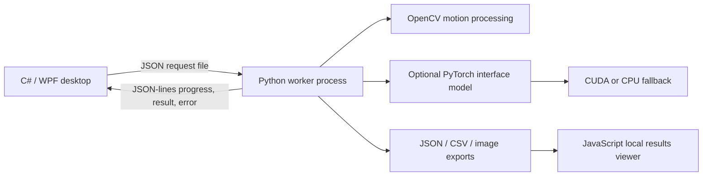

# Architecture

The desktop owns user interaction and workflow state. A separate Python process handles scientific processing. WorkerClient passes arguments with ProcessStartInfo.ArgumentList, reads structured stdout asynchronously, and drains stderr independently. A worker failure is surfaced in the UI with a local log. Closing the app stops the active process tree.

Requests use files because this is a local desktop workflow; no network server is required. The stdout protocol carries one JSON event per line. Progress events update the UI; result events are stored independently for classification, interface and motion. Cancellation uses a flag checked between processing steps. C# async awaits keep the UI responsive while the worker performs computation.

WorkflowNavigator awaits classification, interface detection when eligible, and motion. Fully dispersed/mixed classes record an explicit interface skip. A duplicate-advance guard prevents two chains. Failure or cancellation stops subsequent stages. AnalysisSessionState clones JsonElement values so cached results outlive the document used to parse them. ROI/calibration and shared-frame edits invalidate the appropriate caches.

The portfolio's generated sample has a separate motion-only path. It has no physical flow regime to classify. This path does not fill classification/interface caches with mock results.

The browser viewer consumes the existing export format rather than starting Python or probing the browser's GPU. It validates JSON before rendering, displays original frame IDs, holds fixed profile axes across pairs, separates line segments around missing values, and uses an actual recorded runtime field for the device display. Imported files are local object URLs and are not sent to a server. It is also usable as a static site if explicitly hosted later.

The boundary model uses an image-only small U-Net. CUDA selection probes an actual kernel. Initialization or CUDA execution failures reload the same checked state dictionary on CPU. A corrupted checkpoint produces an error rather than a silently substituted prediction. Flow classification and Farnebäck motion remain CPU operations.
